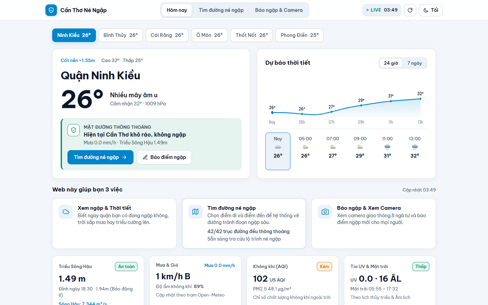
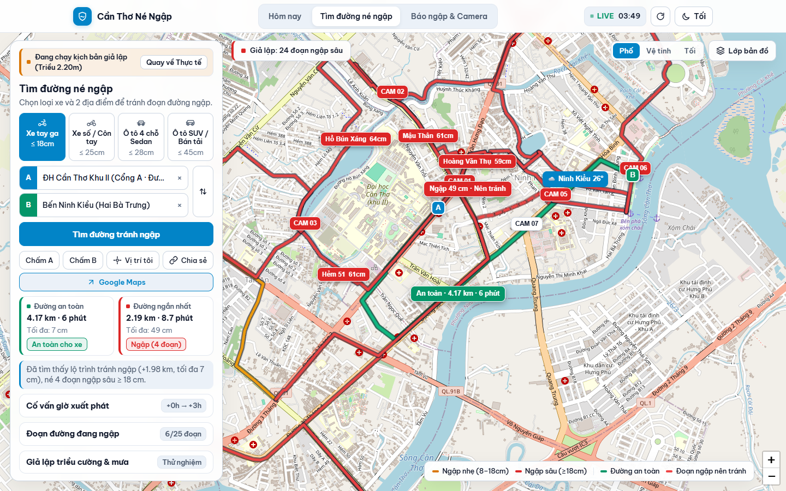

# Cần Thơ Né Ngập

**Ứng dụng web hỗ trợ người dân TP. Cần Thơ xem nhanh tình hình ngập & thời tiết 6 quận/huyện, theo dõi thủy triều Sông Hậu, tìm đường né ngập theo loại xe và xem phản ánh hiện trường cộng đồng.**

[**Trải nghiệm trực tiếp**](https://cantho-hydro-atlas.vercel.app) · [**Mở Bản đồ Né ngập**](https://cantho-hydro-atlas.vercel.app/?mode=flood&from=dhct_khu2&to=ben_ninh_kieu&veh=scooter)

  

---

## Giới Thiệu

Đây là một mini project cá nhân được xây dựng với mong muốn mang lại công cụ tra cứu nhanh, dễ dùng trên cả máy tính lẫn điện thoại cho người dân và người tham gia giao thông tại TP. Cần Thơ — đặc biệt vào những ngày mưa lớn kết hợp triều cường dâng cao.

---

## Hướng Dẫn Sử Dụng

Ứng dụng gồm 3 mục chính ngay trên thanh điều hướng phía trên (có nút chuyển đổi giao diện **Tối / Sáng** ở góc phải):

### 1 · Theo dõi Thời tiết & Tình hình Ngập (`Hôm nay`)
- Chọn nhanh **6 Quận/Huyện** (*Ninh Kiều, Bình Thủy, Cái Răng, Ô Môn, Thốt Nốt, Phong Điền*) để xem nhiệt độ, câu trả lời nhanh xem mặt đường đang khô ráo hay ngập, độ ẩm, chỉ số chất lượng không khí (`US AQI`, `PM2.5`), chỉ số `UV` và giờ mặt trời mọc/lặn.
- Bấm xem dự báo theo **24 giờ**, **7 ngày**, hoặc bấm thẳng vào 3 thẻ gợi ý **Web này giúp bạn 3 việc** để chuyển nhanh tới tính năng cần dùng.
- Mở mục **Xem biểu đồ mực nước Sông Hậu & chi tiết thủy văn** ở cuối trang khi muốn đối chiếu trực tiếp mực triều với cốt nền từng khu vực và các ngưỡng báo động I/II/III.

### 2 · Bản đồ & Tìm đường Né ngập (`Tìm đường né ngập`)
- **Chọn phương tiện đang đi:** *Xe tay ga*, *Xe số/Côn tay*, *Ô tô 4 chỗ Sedan* hoặc *Ô tô gầm cao SUV/Bán tải* để hệ thống tính ngưỡng ngập an toàn phù hợp.
- **Chọn điểm đi (A) và điểm đến (B):** Gõ tên địa điểm quen thuộc ở Cần Thơ (trường học, bệnh viện, siêu thị, cầu, bến xe, tên đường...), bấm nút đổi chiều A ↔ B, chọn **`Vị trí tôi`**, hoặc bấm **`Chấm A`** / **`Chấm B`** rồi chạm trực tiếp lên bản đồ.
- **So sánh & đi theo lộ trình an toàn:** Xem đối chiếu giữa **Đường an toàn** và **Đường ngắn nhất**, bấm **`Google Maps`** để mở lộ trình né ngập sang ứng dụng Google Maps trên điện thoại, hoặc mở các ngăn **Cố vấn giờ xuất phát**, **Đoạn đường đang ngập** và **Giả lập triều cường & mưa** để thử trước các kịch bản ngập.

### 3 · Báo ngập & Camera Giao lộ (`Báo ngập & Camera`)
- **Chia sẻ tình hình đường phố:** Làm theo 3 bước đơn giản — chọn quận/huyện, chọn trạng thái (*Ngập sâu*, *Ngập nhẹ*, *Kẹt xe*, *Mưa lớn*, *Khô thoáng*) cùng mực nước ước lượng (cm) / vị trí, rồi đính kèm ảnh chụp thực tế để cảnh báo mọi người.
- **Xác nhận thông tin nhanh:** Bấm **`+1 Xác nhận`**, **`Đã rút nước`** hoặc bình luận cập nhật thêm dưới bài đăng; các tin báo sẽ tự động hết hiệu lực khi nước rút hoặc quá thời gian quy định. Có sẵn nút **`Xem dữ liệu mẫu`** để bạn xem thử cách hiển thị trên bản đồ mà không ảnh hưởng đến dữ liệu thật.
- **Theo dõi 8 Trạm Camera Giao lộ (`CAM 01` – `CAM 08`):** Bấm chọn từng nút giao trọng điểm để xem mực nước ước lượng, ảnh cộng đồng mới nhất quanh ngã tư hoặc mở thẳng **Google Street View** tại góc đường đó.

---

## Giao Diện Thực Tế

<table>
  <tr>
    <td width="50%">
      <strong>Hôm nay — Chế độ Sáng</strong>  
      
    </td>
    <td width="50%">
      <strong>Hôm nay — Chế độ Tối</strong>  
      
    </td>
  </tr>
  <tr>
    <td width="50%">
      <strong>Tìm đường né ngập A/B &amp; Google Maps</strong>  
      
    </td>
    <td width="50%">
      <strong>Báo ngập &amp; 8 Trạm Camera Giao lộ</strong>  
      
    </td>
  </tr>
  <tr>
    <td colspan="2" align="center">
      <strong>Giao diện Điện thoại (390×844)</strong>  
      
    </td>
  </tr>
</table>

---

## Lời Cảm Ơn

Xin gửi lời cảm ơn chân thành đến:
- Các nguồn dữ liệu mở và nền tảng bản đồ miễn phí như **Open-Meteo**, **GloFAS**, **OpenStreetMap** và **Leaflet** đã cung cấp dữ liệu thời tiết, lưu lượng dòng chảy và bản đồ đường phố Cần Thơ phục vụ cho dự án cá nhân này.
- Mọi người dùng đã ghé thăm, trải nghiệm thử và đóng góp các phản ánh thực tế giúp ích cho việc di chuyển an toàn tại Cần Thơ.

---

## Tác Giả & Liên Hệ

- **Tác giả:** `vcphat`
- **Email:** [26730121@ms.uit.edu.vn](mailto:26730121@ms.uit.edu.vn)
- **GitHub:** [https://github.com/vocuongphat06-collab](https://github.com/vocuongphat06-collab)
- **Facebook:** [https://www.facebook.com/zokuongfak/](https://www.facebook.com/zokuongfak/)
- **Giấy phép:** [MIT License](LICENSE)
